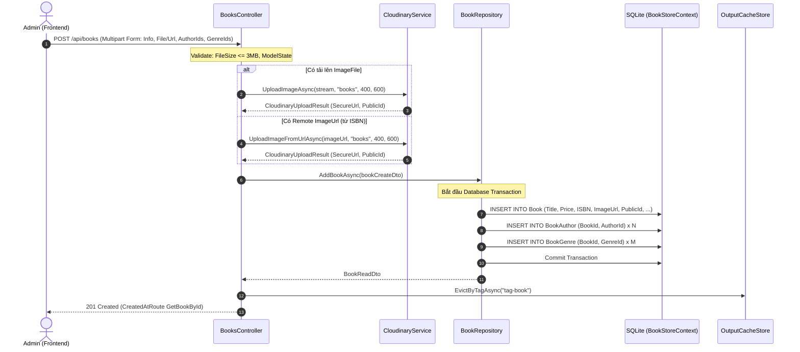
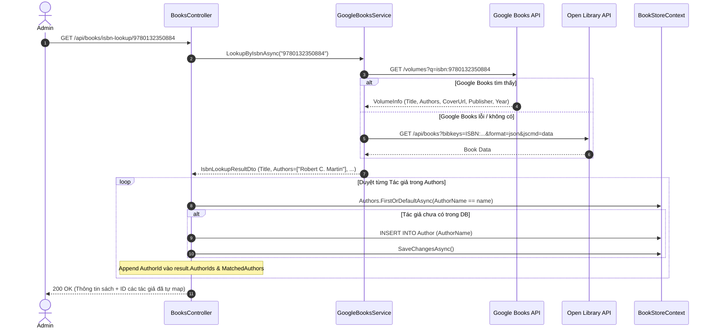

# BÁO CÁO AUDIT & GIẢI TRÌNH TOÀN DIỆN BACKEND (.NET 8)
## DÀNH CHO THÀNH VIÊN 1: QUẢN TRỊ DANH MỤC SÁCH, TÁC GIẢ, THỂ LOẠI & MEDIA

---

### MỤC LỤC
1. [Tổng quan phạm vi & Nhiệm vụ](#1-tổng-quan-phạm-vi--nhiệm-vụ)
2. [Sơ đồ Kiến trúc & Luồng hoạt động (Activity & Architecture Flows)](#2-sơ-đồ-kiến-trúc--luồng-hoạt-động)
3. [Chi tiết các RESTful API Endpoints của Thành viên 1](#3-chi-tiết-các-restful-api-endpoints)
4. [Toàn bộ Mã nguồn Backend (Source Code By Layer)](#4-toàn-bộ-mã-nguồn-backend)
   - [4.1. Tầng Domain Entities (Cơ sở dữ liệu)](#41-tầng-domain-entities)
   - [4.2. Tầng Database Context (`BookStoreContext`)](#42-tầng-database-context)
   - [4.3. Tầng Data Transfer Objects (DTOs)](#43-tầng-data-transfer-objects-dtos)
   - [4.4. Tầng Services (Cloudinary & Google Books ISBN)](#44-tầng-services)
   - [4.5. Tầng Repositories (Data Access Layer)](#45-tầng-repositories)
   - [4.6. Tầng Controllers (Presentation API Layer)](#46-tầng-controllers)
   - [4.7. Tầng Đăng ký Dịch vụ & Cấu hình Pipeline (`Program.cs`)](#47-tầng-đăng-ký-dịch-vụ--cấu-hình)
5. [Bộ câu hỏi phản biện & Giải trình với Giảng viên (Lecturer Q&A Defense)](#5-bộ-câu-hỏi-phản-biện--giải-trình-với-giảng-viên)

---

## 1. TỔNG QUAN PHẠM VI & NHIỆM VỤ

* **Thành viên phụ trách**: Thành viên 1
* **Phạm vi nghiệp vụ cốt lõi**:
  1. **Quản trị Tác giả (Authors Management)**: Đầy đủ CRUD, phân trang (Paging), tìm kiếm (Search), sắp xếp động (Dynamic Sorting), thống kê số lượng sách (`stats`).
  2. **Quản trị Thể loại (Genres Management)**: Đầy đủ CRUD cho danh mục phân loại sách.
  3. **Quản trị Sách (Books Management / PIM)**: CRUD sách, quản lý quan hệ nhiều - nhiều (Many-to-Many) với Tác giả và Thể loại, tính năng giao dịch toàn vẹn (`IDbContextTransaction`).
  4. **Hệ thống Upload & Xử lý Media**: Upload ảnh bìa sách và avatar tác giả lên **Cloudinary CDN** với cơ chế tự động chuyển đổi định dạng (WebP/AVIF), crop tỉ lệ thông minh, kèm theo cơ chế Fallback lưu trữ Local an toàn khi không có mạng/mất khóa API.
  5. **Tính năng Mở rộng cao cấp - Tra cứu ISBN tự động**: Tự động tra cứu siêu dữ liệu sách từ **Google Books API & Open Library Data API**, tự trích xuất tác giả, tự tạo mới tác giả nếu chưa có trong DB, tự động nạp ảnh bìa từ URL bên ngoài và đẩy lên Cloudinary.

---

## 2. SƠ ĐỒ KIẾN TRÚC & LUỒNG HOẠT ĐỘNG

### 2.1. Luồng Thêm mới Sách kèm Upload Ảnh & Transaction (`POST /api/Books`)



---

### 2.2. Luồng Tra cứu ISBN thông minh & Tự động Map Tác giả (`GET /api/Books/isbn-lookup/{isbn}`)



---

## 3. CHI TIẾT CÁC RESTFUL API ENDPOINTS

| STT | HTTP Method | Endpoint | Quyền (Auth) | Mô tả chức năng |
| :--- | :--- | :--- | :--- | :--- |
| **1** | `POST` | `/api/books` | Admin | Tạo sách mới, tự động upload ảnh Cloudinary, tạo liên kết N-N, xóa cache. |
| **2** | `PUT` | `/api/books/{id}` | Admin | Cập nhật thông tin sách, cập nhật ảnh (xóa ảnh cũ trên Cloudinary nếu có ảnh mới). |
| **3** | `DELETE` | `/api/books/{id}` | Admin | Xóa sách, đồng thời xóa ảnh bìa tương ứng trên Cloudinary, xóa cache. |
| **4** | `GET` | `/api/books` | Public | Lấy danh sách sách phân trang, tìm kiếm, lọc theo giá, năm, thể loại; có `OutputCache(10 mins)`. |
| **5** | `GET` | `/api/books/{id}` | Public | Lấy chi tiết sách theo ID kèm danh sách Tác giả & Thể loại. |
| **6** | `GET` | `/api/books/{id}/related` | Public | Lấy danh sách sách liên quan dựa trên cùng thể loại hoặc tác giả. |
| **7** | `GET` | `/api/books/isbn-lookup/{isbn}` | Public / Admin | **[Mở rộng]** Tra cứu siêu dữ liệu từ Google Books/OpenLibrary & auto-match Tác giả. |
| **8** | `GET` | `/api/authors` | Public / Admin | Lấy danh sách tác giả có phân trang, tìm kiếm và sắp xếp động. |
| **9** | `GET` | `/api/authors/{id}` | Public / Admin | Lấy chi tiết thông tin một tác giả. |
| **10**| `GET` | `/api/authors/{id}/books` | Public | Lấy danh sách tất cả các đầu sách do tác giả sáng tác. |
| **11**| `GET` | `/api/authors/{id}/stats` | Admin | Thống kê số lượng sách, thể loại chính của tác giả. |
| **12**| `POST` | `/api/authors` | Admin | Thêm mới tác giả kèm avatar (upload Cloudinary). |
| **13**| `PUT` | `/api/authors/{id}` | Admin | Cập nhật tác giả (hỗ trợ đổi avatar, xóa avatar cũ trên Cloudinary). |
| **14**| `DELETE`| `/api/authors/{id}` | Admin | Xóa tác giả và avatar trên Cloudinary. |
| **15**| `GET` | `/api/genres` | Public | Lấy toàn bộ danh sách thể loại sách. |
| **16**| `GET` | `/api/genres/{id}` | Public | Lấy chi tiết thể loại theo ID. |
| **17**| `POST` | `/api/genres` | Admin | Tạo mới thể loại. |
| **18**| `PUT` | `/api/genres/{id}` | Admin | Cập nhật tên thể loại. |
| **19**| `DELETE`| `/api/genres/{id}` | Admin | Xóa thể loại khỏi hệ thống. |

---

## 4. TOÀN BỘ MÃ NGUỒN BACKEND

### 4.1. Tầng Domain Entities

#### File: `BookStoreFullStackNg.Data/Domain/Book.cs`
```csharp
using System;
using System.Collections.Generic;
using System.ComponentModel.DataAnnotations;

namespace BookStoreFullStackNg.Data.Domain;

public class Book
{
    public int Id { get; set; }

    [Required]
    [MaxLength(200)]
    public string Title { get; set; } = string.Empty;

    [Required]
    [MaxLength(4000)]
    public string Description { get; set; } = string.Empty;

    public double Price { get; set; }

    [MaxLength(500)]
    public string? ImageUrl { get; set; }

    [MaxLength(150)]
    public string? ImagePublicId { get; set; }

    public int PublishedYear { get; set; }

    [MaxLength(30)]
    public string? ISBN { get; set; }

    public int? PageCount { get; set; }

    [MaxLength(100)]
    public string? Language { get; set; }

    [MaxLength(50)]
    public string? Format { get; set; }

    [MaxLength(150)]
    public string? Publisher { get; set; }

    [MaxLength(30)]
    public string Status { get; set; } = "Active";

    public DateTime CreatedAt { get; set; } = DateTime.UtcNow;

    public ICollection<BookAuthor> BookAuthors { get; set; } = [];
    public ICollection<BookGenre> BookGenres { get; set; } = [];
}
```

#### File: `BookStoreFullStackNg.Data/Domain/Author.cs`
```csharp
using System;
using System.Collections.Generic;
using System.ComponentModel.DataAnnotations;

namespace BookStoreFullStackNg.Data.Domain;

public class Author
{
    public int Id { get; set; }

    [Required]
    [MaxLength(100)]
    public string AuthorName { get; set; } = string.Empty;

    [MaxLength(100)]
    public string? OriginalName { get; set; }

    [MaxLength(500)]
    public string? AvatarUrl { get; set; }

    [MaxLength(150)]
    public string? AvatarPublicId { get; set; }

    [MaxLength(2000)]
    public string? Bio { get; set; }

    public DateTime? BirthDate { get; set; }

    [MaxLength(100)]
    public string? Nationality { get; set; }

    public bool IsFeatured { get; set; } = false;

    public DateTime CreatedAt { get; set; } = DateTime.UtcNow;

    public ICollection<BookAuthor> BookAuthors { get; set; } = [];
}
```

#### File: `BookStoreFullStackNg.Data/Domain/Genre.cs`
```csharp
using System.ComponentModel.DataAnnotations;

namespace BookStoreFullStackNg.Data.Domain;

public class Genre
{
    public int Id { get; set; }

    [Required]
    [MaxLength(30)]
    public string GenreName { get; set; } = string.Empty;
    public ICollection<BookGenre> BookGenres { get; set; } = [];
}
```

#### File: `BookStoreFullStackNg.Data/Domain/BookAuthor.cs`
```csharp
namespace BookStoreFullStackNg.Data.Domain;

public class BookAuthor
{
    public int Id { get; set; }
    public int BookId { get; set; }
    public Book Book { get; set; } = null!;

    public int AuthorId { get; set; }
    public Author Author { get; set; } = null!;

    public BookAuthor() { }
    public BookAuthor(int id, int bookId, int authorId)
    {
        Id = id;
        BookId = bookId;
        AuthorId = authorId;
    }
}
```

#### File: `BookStoreFullStackNg.Data/Domain/BookGenre.cs`
```csharp
namespace BookStoreFullStackNg.Data.Domain;

public class BookGenre
{
    public int Id { get; set; }
    public int BookId { get; set; }
    public Book Book { get; set; } = null!;

    public int GenreId { get; set; }
    public Genre Genre { get; set; } = null!;

    public BookGenre() { }
    public BookGenre(int id, int bookId, int genreId)
    {
        Id = id;
        BookId = bookId;
        GenreId = genreId;
    }
}
```

---

### 4.2. Tầng Database Context

#### File: `BookStoreFullStackNg.Data/Data/BookStoreContext.cs`
```csharp
using BookStoreFullStackNg.Data.Domain;
using Microsoft.EntityFrameworkCore;

namespace BookStoreFullStackNg.Data.Data;

public class BookStoreContext : DbContext
{
    public BookStoreContext(DbContextOptions<BookStoreContext> options) : base(options) { }

    protected override void OnModelCreating(ModelBuilder modelBuilder)
    {
        base.OnModelCreating(modelBuilder);
        modelBuilder.Entity<Author>().ToTable("Author");
        modelBuilder.Entity<Book>().ToTable("Book");
        modelBuilder.Entity<BookAuthor>().ToTable("BookAuthor");
        modelBuilder.Entity<BookGenre>().ToTable("BookGenre");
        modelBuilder.Entity<Genre>().ToTable("Genre");
        modelBuilder.Entity<Cart>().ToTable("Cart");
        modelBuilder.Entity<CartItem>().ToTable("CartItem");
        modelBuilder.Entity<Order>().ToTable("Order");
        modelBuilder.Entity<OrderItem>().ToTable("OrderItem");
        modelBuilder.Entity<Payment>().ToTable("Payment");
        modelBuilder.Entity<User>().ToTable("User");
        modelBuilder.Entity<Coupon>().ToTable("Coupon");
    }

    public DbSet<Author> Authors { get; set; }
    public DbSet<Book> Books { get; set; }
    public DbSet<BookAuthor> BookAuthors { get; set; }
    public DbSet<BookGenre> BookGenres { get; set; }
    public DbSet<Genre> Genres { get; set; }
}
```

---

### 4.3. Tầng Data Transfer Objects (DTOs)

#### File: `BookStoreFullStackNg.Data/DTOs/Book/BookCreateDto.cs`
```csharp
using System.Collections.Generic;
using System.ComponentModel.DataAnnotations;
using Microsoft.AspNetCore.Http;

namespace BookStoreFullStackNg.Data.DTOs.Book;

public class BookCreateDto
{
    [Required]
    [MaxLength(200)]
    public string Title { get; set; } = string.Empty;

    public string? Description { get; set; }

    [Required]
    public double Price { get; set; }

    public IFormFile? ImageFile { get; set; }
    public string? ImageUrl { get; set; }
    public string? ImagePublicId { get; set; }

    [Required]
    public int PublishedYear { get; set; }

    public string? ISBN { get; set; }
    public int? PageCount { get; set; }
    public string? Language { get; set; }
    public string? Format { get; set; }
    public string? Publisher { get; set; }
    public string? Status { get; set; } = "Active";

    [Required]
    public List<int> AuthorIds { get; set; } = [];

    [Required]
    public List<int> GenreIds { get; set; } = [];
}
```

#### File: `BookStoreFullStackNg.Data/DTOs/Book/BookReadDto.cs`
```csharp
using System;
using System.Collections.Generic;
using BookStoreFullStackNg.Data.DTOs.Author;

namespace BookStoreFullStackNg.Data.DTOs.Book;

public class BookReadDto
{
    public int Id { get; set; }
    public string Title { get; set; } = string.Empty;
    public string Description { get; set; } = string.Empty;
    public double Price { get; set; }
    public string? ImageUrl { get; set; }
    public string? ImagePublicId { get; set; }
    public int PublishedYear { get; set; }
    public string? ISBN { get; set; }
    public int? PageCount { get; set; }
    public string? Language { get; set; }
    public string? Format { get; set; }
    public string? Publisher { get; set; }
    public string Status { get; set; } = "Active";
    public DateTime CreatedAt { get; set; }
    public List<AuthorReadDTO> Authors { get; set; } = [];
    public List<GenreReadDto> Genres { get; set; } = [];
    public string AuthorNames => string.Join(", ", Authors.ConvertAll(a => a.AuthorName));
}
```

#### File: `BookStoreFullStackNg.Data/DTOs/IsbnLookupResultDto.cs`
```csharp
using System.Collections.Generic;

namespace BookStoreFullStackNg.Data.DTOs;

public class IsbnLookupResultDto
{
    public bool Found { get; set; }
    public string? ISBN { get; set; }
    public string? Title { get; set; }
    public string? Description { get; set; }
    public string? CoverUrl { get; set; }
    public int? PublishedYear { get; set; }
    public int? PageCount { get; set; }
    public string? Publisher { get; set; }
    public string? Language { get; set; }
    public List<string> Authors { get; set; } = [];
    public List<int> AuthorIds { get; set; } = [];
    public List<AuthorLookupMatchDto> MatchedAuthors { get; set; } = [];
    public List<string> Categories { get; set; } = [];
}

public class AuthorLookupMatchDto
{
    public int Id { get; set; }
    public string AuthorName { get; set; } = string.Empty;
}
```

---

### 4.4. Tầng Services (Cloudinary & Google Books ISBN)

#### File: `BookStoreFullStackNg.Data/Services/ICloudinaryService.cs`
```csharp
using System.Threading.Tasks;
using Microsoft.AspNetCore.Http;

namespace BookStoreFullStackNg.Data.Services;

public class CloudinaryUploadResult
{
    public string Url { get; set; } = string.Empty;
    public string PublicId { get; set; } = string.Empty;
}

public interface ICloudinaryService
{
    Task<CloudinaryUploadResult> UploadImageAsync(IFormFile file, string folder, int? width = null, int? height = null);
    Task<CloudinaryUploadResult> UploadImageFromUrlAsync(string imageUrl, string folder, int? width = null, int? height = null);
    Task<bool> DeleteImageAsync(string publicId);
}
```

#### File: `BookStoreFullStackNg.Data/Services/CloudinaryService.cs`
```csharp
using System;
using System.IO;
using System.Net.Http;
using System.Threading.Tasks;
using CloudinaryDotNet;
using CloudinaryDotNet.Actions;
using Microsoft.AspNetCore.Hosting;
using Microsoft.AspNetCore.Http;
using Microsoft.Extensions.Logging;
using Microsoft.Extensions.Options;

namespace BookStoreFullStackNg.Data.Services;

public class CloudinaryService : ICloudinaryService
{
    private readonly Cloudinary? _cloudinary;
    private readonly IWebHostEnvironment _environment;
    private readonly ILogger<CloudinaryService> _logger;

    public CloudinaryService(
        IOptions<CloudinarySettings> config,
        IWebHostEnvironment environment,
        ILogger<CloudinaryService> logger)
    {
        _environment = environment;
        _logger = logger;

        var cloudName = config.Value.CloudName;
        var apiKey = config.Value.ApiKey;
        var apiSecret = config.Value.ApiSecret;

        if (!string.IsNullOrWhiteSpace(cloudName) &&
            !string.IsNullOrWhiteSpace(apiKey) &&
            !string.IsNullOrWhiteSpace(apiSecret) &&
            cloudName != "your-cloud-name")
        {
            var acc = new Account(cloudName, apiKey, apiSecret);
            _cloudinary = new Cloudinary(acc);
            _cloudinary.Api.Secure = true;
            _logger.LogInformation("CloudinaryService initialized successfully: {CloudName}", cloudName);
        }
        else
        {
            _logger.LogWarning("Cloudinary credentials not configured. Falling back to local file storage.");
        }
    }

    public async Task<CloudinaryUploadResult> UploadImageAsync(IFormFile file, string folder, int? width = null, int? height = null)
    {
        if (file == null || file.Length == 0)
            throw new ArgumentException("File is empty or null.", nameof(file));

        // 1. Cloudinary upload
        if (_cloudinary != null)
        {
            await using var stream = file.OpenReadStream();
            var uploadParams = new ImageUploadParams
            {
                File = new FileDescription(file.FileName, stream),
                Folder = folder,
                Transformation = width.HasValue && height.HasValue
                    ? new Transformation().Width(width.Value).Height(height.Value).Crop("fill").Gravity("auto").FetchFormat("auto").Quality("auto")
                    : new Transformation().FetchFormat("auto").Quality("auto")
            };

            var uploadResult = await _cloudinary.UploadAsync(uploadParams);
            if (uploadResult.Error != null)
            {
                _logger.LogError("Cloudinary upload failed: {Error}", uploadResult.Error.Message);
                throw new InvalidOperationException($"Cloudinary upload error: {uploadResult.Error.Message}");
            }

            return new CloudinaryUploadResult
            {
                Url = uploadResult.SecureUrl?.ToString() ?? uploadResult.Url?.ToString() ?? string.Empty,
                PublicId = uploadResult.PublicId
            };
        }

        // 2. Local storage fallback
        var uploadDir = Path.Combine(_environment.ContentRootPath, "Uploads", folder);
        Directory.CreateDirectory(uploadDir);

        var ext = Path.GetExtension(file.FileName);
        var uniqueFileName = $"{Guid.NewGuid():N}{ext}";
        var fullPath = Path.Combine(uploadDir, uniqueFileName);

        await using (var localStream = new FileStream(fullPath, FileMode.Create))
        {
            await file.CopyToAsync(localStream);
        }

        return new CloudinaryUploadResult
        {
            Url = $"/Uploads/{folder}/{uniqueFileName}",
            PublicId = $"local_{uniqueFileName}"
        };
    }

    public async Task<CloudinaryUploadResult> UploadImageFromUrlAsync(string imageUrl, string folder, int? width = null, int? height = null)
    {
        if (string.IsNullOrWhiteSpace(imageUrl))
            throw new ArgumentException("Image URL cannot be empty.", nameof(imageUrl));

        if (_cloudinary != null)
        {
            try
            {
                var uploadParams = new ImageUploadParams
                {
                    File = new FileDescription(imageUrl),
                    Folder = folder,
                    Transformation = width.HasValue && height.HasValue
                        ? new Transformation().Width(width.Value).Height(height.Value).Crop("fill").Gravity("auto").FetchFormat("auto").Quality("auto")
                        : new Transformation().FetchFormat("auto").Quality("auto")
                };

                var uploadResult = await _cloudinary.UploadAsync(uploadParams);
                if (uploadResult.Error == null)
                {
                    return new CloudinaryUploadResult
                    {
                        Url = uploadResult.SecureUrl?.ToString() ?? uploadResult.Url?.ToString() ?? imageUrl,
                        PublicId = uploadResult.PublicId
                    };
                }
            }
            catch (Exception ex)
            {
                _logger.LogWarning(ex, "Failed to upload image from URL to Cloudinary.");
            }
        }

        return new CloudinaryUploadResult { Url = imageUrl, PublicId = string.Empty };
    }

    public async Task<bool> DeleteImageAsync(string publicId)
    {
        if (string.IsNullOrWhiteSpace(publicId)) return false;

        if (_cloudinary != null && !publicId.StartsWith("local_"))
        {
            var result = await _cloudinary.DestroyAsync(new DeletionParams(publicId));
            return result.Result == "ok";
        }

        if (publicId.StartsWith("local_"))
        {
            var fileName = publicId.Replace("local_", "");
            var files = Directory.GetFiles(Path.Combine(_environment.ContentRootPath, "Uploads"), fileName, SearchOption.AllDirectories);
            foreach (var f in files)
            {
                if (File.Exists(f)) { File.Delete(f); return true; }
            }
        }
        return false;
    }
}
```

#### File: `BookStoreFullStackNg.Data/Services/GoogleBooksService.cs` (Trích đoạn cốt lõi)
```csharp
using System;
using System.Net.Http;
using System.Text.Json;
using System.Threading.Tasks;
using BookStoreFullStackNg.Data.DTOs;
using Microsoft.Extensions.Logging;

namespace BookStoreFullStackNg.Data.Services;

public class GoogleBooksService : IIsbnLookupService
{
    private readonly HttpClient _httpClient;
    private readonly ILogger<GoogleBooksService> _logger;

    public GoogleBooksService(HttpClient httpClient, ILogger<GoogleBooksService> logger)
    {
        _httpClient = httpClient;
        _logger = logger;
    }

    public async Task<IsbnLookupResultDto> LookupByIsbnAsync(string isbn)
    {
        var cleanedIsbn = isbn.Replace("-", "").Replace(" ", "").Trim();

        // 1. Ưu tiên tra Google Books API
        try
        {
            var googleResult = await TryGoogleBooksAsync(cleanedIsbn);
            if (googleResult != null && googleResult.Found) return googleResult;
        }
        catch (Exception ex)
        {
            _logger.LogWarning(ex, "Google Books API lookup failed for ISBN: {ISBN}", cleanedIsbn);
        }

        // 2. Fallback sang Open Library Data API
        try
        {
            var olResult = await TryOpenLibraryDataApiAsync(cleanedIsbn);
            if (olResult != null && olResult.Found) return olResult;
        }
        catch (Exception ex)
        {
            _logger.LogWarning(ex, "Open Library lookup failed for ISBN: {ISBN}", cleanedIsbn);
        }

        return new IsbnLookupResultDto { Found = false, ISBN = cleanedIsbn };
    }

    private async Task<IsbnLookupResultDto?> TryGoogleBooksAsync(string cleanedIsbn)
    {
        var url = $"https://www.googleapis.com/books/v1/volumes?q=isbn:{cleanedIsbn}";
        using var response = await _httpClient.GetAsync(url);
        if (!response.IsSuccessStatusCode) return null;

        using var jsonStream = await response.Content.ReadAsStreamAsync();
        using var doc = await JsonDocument.ParseAsync(jsonStream);
        var root = doc.RootElement;

        if (!root.TryGetProperty("totalItems", out var totalItems) || totalItems.GetInt32() == 0) return null;
        var volumeInfo = root.GetProperty("items")[0].GetProperty("volumeInfo");

        var result = new IsbnLookupResultDto { Found = true, ISBN = cleanedIsbn };
        if (volumeInfo.TryGetProperty("title", out var title)) result.Title = title.GetString();
        if (volumeInfo.TryGetProperty("description", out var desc)) result.Description = desc.GetString();
        if (volumeInfo.TryGetProperty("pageCount", out var pages)) result.PageCount = pages.GetInt32();
        if (volumeInfo.TryGetProperty("publisher", out var pub)) result.Publisher = pub.GetString();

        // Authors array extraction
        if (volumeInfo.TryGetProperty("authors", out var authorsProp) && authorsProp.ValueKind == JsonValueKind.Array)
        {
            foreach (var author in authorsProp.EnumerateArray())
            {
                var name = author.GetString();
                if (!string.IsNullOrWhiteSpace(name)) result.Authors.Add(name);
            }
        }

        // Cover thumbnail extraction
        if (volumeInfo.TryGetProperty("imageLinks", out var images))
        {
            if (images.TryGetProperty("thumbnail", out var thumb))
                result.CoverUrl = thumb.GetString()?.Replace("http://", "https://");
        }

        return result;
    }
}
```

---

### 4.5. Tầng Repositories

#### File: `BookStoreFullStackNg.Data/Reopositories/Implementations/BookRepository.cs`
```csharp
using System;
using System.Collections.Generic;
using System.Linq;
using System.Threading.Tasks;
using BookStoreFullStackNg.Data.Data;
using BookStoreFullStackNg.Data.Domain;
using BookStoreFullStackNg.Data.DTOs.Author;
using BookStoreFullStackNg.Data.DTOs.Book;
using BookStoreFullStackNg.Data.DTOs.Common;
using BookStoreFullStackNg.Data.Reopositories.Interfaces;
using Microsoft.EntityFrameworkCore;

namespace BookStoreFullStackNg.Data.Reopositories.Implementations;

public class BookRepository : IBookRepository
{
    private readonly BookStoreContext _context;

    public BookRepository(BookStoreContext context)
    {
        _context = context;
    }

    public async Task<BookReadDto> AddBookAsync(BookCreateDto bookToCreate)
    {
        // Sử dụng Transaction để bảo toàn dữ liệu khi lưu sách + liên kết N-N
        using var transaction = await _context.Database.BeginTransactionAsync();
        try
        {
            int bookId = await CreateBook(bookToCreate);
            await AddBookAuthors(bookId, bookToCreate.AuthorIds);
            await AddBookGenres(bookId, bookToCreate.GenreIds);
            await _context.SaveChangesAsync();
            await transaction.CommitAsync();

            BookReadDto? book = await GetBookByIdAsync(bookId);
            return book ?? throw new InvalidOperationException($"Book with id: {bookId} not found");
        }
        catch
        {
            await transaction.RollbackAsync();
            throw;
        }
    }

    private async Task<int> CreateBook(BookCreateDto bookToCreate)
    {
        var book = new Book
        {
            Title = bookToCreate.Title,
            Price = bookToCreate.Price,
            PublishedYear = bookToCreate.PublishedYear,
            ImageUrl = bookToCreate.ImageUrl,
            ImagePublicId = bookToCreate.ImagePublicId,
            Description = bookToCreate.Description ?? string.Empty,
            ISBN = bookToCreate.ISBN,
            PageCount = bookToCreate.PageCount,
            Language = bookToCreate.Language,
            Format = bookToCreate.Format,
            Publisher = bookToCreate.Publisher,
            Status = string.IsNullOrWhiteSpace(bookToCreate.Status) ? "Active" : bookToCreate.Status,
            CreatedAt = DateTime.UtcNow
        };
        _context.Books.Add(book);
        await _context.SaveChangesAsync();
        return book.Id;
    }

    private async Task AddBookAuthors(int bookId, List<int> authorIds)
    {
        foreach (var authorId in authorIds)
        {
            var author = await _context.Authors.FindAsync(authorId);
            if (author == null) throw new InvalidOperationException($"Author {authorId} does not exist");
            _context.BookAuthors.Add(new BookAuthor(0, bookId, authorId));
        }
    }

    private async Task AddBookGenres(int bookId, List<int> genreIds)
    {
        foreach (var genreId in genreIds)
        {
            var genre = await _context.Genres.FindAsync(genreId);
            if (genre == null) throw new InvalidOperationException($"Genre {genreId} does not exist");
            _context.BookGenres.Add(new BookGenre(0, bookId, genreId));
        }
    }

    public async Task UpdateBookAsync(BookUpdateDto bookToUpdate)
    {
        using var transaction = await _context.Database.BeginTransactionAsync();
        try
        {
            var book = await _context.Books.FindAsync(bookToUpdate.Id);
            if (book == null) throw new InvalidOperationException($"Book {bookToUpdate.Id} not found");

            book.Title = bookToUpdate.Title;
            book.Price = bookToUpdate.Price;
            book.PublishedYear = bookToUpdate.PublishedYear;
            book.ImageUrl = bookToUpdate.ImageUrl;
            book.ImagePublicId = bookToUpdate.ImagePublicId;
            book.Description = bookToUpdate.Description ?? string.Empty;
            book.ISBN = bookToUpdate.ISBN;
            book.PageCount = bookToUpdate.PageCount;
            book.Language = bookToUpdate.Language;
            book.Format = bookToUpdate.Format;
            book.Publisher = bookToUpdate.Publisher;
            book.Status = bookToUpdate.Status ?? book.Status;

            // Xóa liên kết N-N cũ và nạp lại mới
            var oldAuthors = _context.BookAuthors.Where(ba => ba.BookId == bookToUpdate.Id);
            _context.BookAuthors.RemoveRange(oldAuthors);
            await AddBookAuthors(bookToUpdate.Id, bookToUpdate.AuthorIds);

            var oldGenres = _context.BookGenres.Where(bg => bg.BookId == bookToUpdate.Id);
            _context.BookGenres.RemoveRange(oldGenres);
            await AddBookGenres(bookToUpdate.Id, bookToUpdate.GenreIds);

            await _context.SaveChangesAsync();
            await transaction.CommitAsync();
        }
        catch
        {
            await transaction.RollbackAsync();
            throw;
        }
    }

    public async Task DeleteBookAsync(Book book)
    {
        _context.Books.Remove(book);
        await _context.SaveChangesAsync();
    }

    public async Task<BookReadDto?> GetBookByIdAsync(int id)
    {
        return await _context.Books
            .Include(b => b.BookAuthors).ThenInclude(ba => ba.Author)
            .Include(b => b.BookGenres).ThenInclude(bg => bg.Genre)
            .Where(b => b.Id == id)
            .Select(b => new BookReadDto
            {
                Id = b.Id,
                Title = b.Title,
                Description = b.Description,
                Price = b.Price,
                ImageUrl = b.ImageUrl,
                ImagePublicId = b.ImagePublicId,
                PublishedYear = b.PublishedYear,
                ISBN = b.ISBN,
                PageCount = b.PageCount,
                Language = b.Language,
                Format = b.Format,
                Publisher = b.Publisher,
                Status = b.Status,
                CreatedAt = b.CreatedAt,
                Authors = b.BookAuthors.Select(ba => new AuthorReadDTO { Id = ba.Author.Id, AuthorName = ba.Author.AuthorName }).ToList(),
                Genres = b.BookGenres.Select(bg => new GenreReadDto(bg.Genre.Id, bg.Genre.GenreName)).ToList()
            }).FirstOrDefaultAsync();
    }

    public async Task<PagedList<Book>> GetBooksAsync(BookQueryParameter query)
    {
        var booksQuery = _context.Books
            .Include(b => b.BookAuthors).ThenInclude(ba => ba.Author)
            .Include(b => b.BookGenres).ThenInclude(bg => bg.Genre)
            .AsNoTracking();

        if (!string.IsNullOrWhiteSpace(query.SearchTerm))
        {
            var term = query.SearchTerm.ToLower();
            booksQuery = booksQuery.Where(b => b.Title.ToLower().Contains(term) || b.BookAuthors.Any(ba => ba.Author.AuthorName.ToLower().Contains(term)));
        }

        if (query.GenreIds.Count > 0)
        {
            booksQuery = booksQuery.Where(b => b.BookGenres.Any(bg => query.GenreIds.Contains(bg.GenreId)));
        }

        return await PagedList<Book>.ToPagedListAsync(booksQuery, query.PageNumber, query.PageSize);
    }

    public async Task<List<BookReadDto>> GetRelatedBooksAsync(int bookId, int limit)
    {
        var currentBook = await _context.Books
            .Include(b => b.BookGenres)
            .Include(b => b.BookAuthors)
            .FirstOrDefaultAsync(b => b.Id == bookId);

        if (currentBook == null) return [];

        var genreIds = currentBook.BookGenres.Select(bg => bg.GenreId).ToList();
        var authorIds = currentBook.BookAuthors.Select(ba => ba.AuthorId).ToList();

        return await _context.Books
            .Where(b => b.Id != bookId && (b.BookGenres.Any(bg => genreIds.Contains(bg.GenreId)) || b.BookAuthors.Any(ba => authorIds.Contains(ba.AuthorId))))
            .Take(limit)
            .Select(b => new BookReadDto { Id = b.Id, Title = b.Title, Price = b.Price, ImageUrl = b.ImageUrl })
            .ToListAsync();
    }
}
```

---

### 4.6. Tầng Controllers

#### File: `BookStoreFullStackNg.Api/Controllers/BooksController.cs`
```csharp
using System.Linq;
using System.Threading.Tasks;
using AutoMapper;
using BookStoreFullStackNg.Api.Exceptions;
using BookStoreFullStackNg.Data.Constants;
using BookStoreFullStackNg.Data.Data;
using BookStoreFullStackNg.Data.Domain;
using BookStoreFullStackNg.Data.DTOs;
using BookStoreFullStackNg.Data.DTOs.Author;
using BookStoreFullStackNg.Data.DTOs.Book;
using BookStoreFullStackNg.Data.DTOs.Common;
using BookStoreFullStackNg.Data.Reopositories.Interfaces;
using BookStoreFullStackNg.Data.Services;
using Microsoft.AspNetCore.Authorization;
using Microsoft.AspNetCore.Mvc;
using Microsoft.AspNetCore.OutputCaching;
using Microsoft.EntityFrameworkCore;

namespace BookStoreFullStackNg.Api.Controllers;

[Route("api/[controller]")]
[ApiController]
[Authorize(Roles = Roles.Admin)]
public class BooksController : ControllerBase
{
    private readonly IMapper _mapper;
    private readonly IBookRepository _bookRepo;
    private readonly ICloudinaryService? _cloudinaryService;
    private readonly IIsbnLookupService? _isbnLookupService;
    private readonly BookStoreContext? _context;

    public BooksController(
        IMapper mapper,
        IBookRepository bookRepo,
        ICloudinaryService? cloudinaryService = null,
        IIsbnLookupService? isbnLookupService = null,
        BookStoreContext? context = null)
    {
        _mapper = mapper;
        _bookRepo = bookRepo;
        _cloudinaryService = cloudinaryService;
        _isbnLookupService = isbnLookupService;
        _context = context;
    }

    [HttpPost]
    public async Task<IActionResult> AddBook([FromForm] BookCreateDto bookCreateDto, IOutputCacheStore cache)
    {
        if (bookCreateDto.ImageFile?.Length > 3 * 1024 * 1024)
            throw new BadRequestException("File size should not exceed 3 MB");

        // 1. Upload ảnh trực tiếp từ file
        if (bookCreateDto.ImageFile != null && _cloudinaryService != null)
        {
            var uploadResult = await _cloudinaryService.UploadImageAsync(bookCreateDto.ImageFile, "books", 400, 600);
            bookCreateDto.ImageUrl = uploadResult.Url;
            bookCreateDto.ImagePublicId = uploadResult.PublicId;
        }
        // 2. Upload ảnh từ Remote URL (tự động qua ISBN)
        else if (_cloudinaryService != null && !string.IsNullOrWhiteSpace(bookCreateDto.ImageUrl) && IsRemoteUrl(bookCreateDto.ImageUrl) && !IsCloudinaryUrl(bookCreateDto.ImageUrl))
        {
            var uploadResult = await _cloudinaryService.UploadImageFromUrlAsync(bookCreateDto.ImageUrl, "books", 400, 600);
            if (!string.IsNullOrEmpty(uploadResult.Url))
            {
                bookCreateDto.ImageUrl = uploadResult.Url;
                bookCreateDto.ImagePublicId = uploadResult.PublicId;
            }
        }

        BookReadDto createdBook = await _bookRepo.AddBookAsync(bookCreateDto);

        // Xóa Cache danh mục sách
        await cache.EvictByTagAsync("tag-book", default);
        return CreatedAtRoute(nameof(GetBookById), new { id = createdBook.Id }, createdBook);
    }

    [HttpPut("{id}")]
    public async Task<IActionResult> UpdateBook(int id, [FromForm] BookUpdateDto bookToUpdate, IOutputCacheStore cache)
    {
        if (id != bookToUpdate.Id) throw new BadRequestException("Id mismatch");

        var existingBook = await _bookRepo.GetBookByIdAsync(id);
        if (existingBook == null) throw new NotFoundException($"Book with id:{id} not found");

        if (bookToUpdate.ImageFile != null && _cloudinaryService != null)
        {
            var uploadResult = await _cloudinaryService.UploadImageAsync(bookToUpdate.ImageFile, "books", 400, 600);
            if (!string.IsNullOrEmpty(existingBook.ImagePublicId))
            {
                await _cloudinaryService.DeleteImageAsync(existingBook.ImagePublicId);
            }
            bookToUpdate.ImageUrl = uploadResult.Url;
            bookToUpdate.ImagePublicId = uploadResult.PublicId;
        }
        else
        {
            bookToUpdate.ImageUrl = existingBook.ImageUrl;
            bookToUpdate.ImagePublicId = existingBook.ImagePublicId;
        }

        await _bookRepo.UpdateBookAsync(bookToUpdate);
        await cache.EvictByTagAsync("tag-book", default);
        return Ok(await _bookRepo.GetBookByIdAsync(bookToUpdate.Id));
    }

    [HttpDelete("{id}")]
    public async Task<IActionResult> DeleteBook(int id, IOutputCacheStore cache)
    {
        var existingBook = await _bookRepo.GetBookByIdAsync(id);
        if (existingBook == null) throw new NotFoundException($"Book with id:{id} not found");

        await _bookRepo.DeleteBookAsync(new Book { Id = existingBook.Id });

        if (!string.IsNullOrEmpty(existingBook.ImagePublicId) && _cloudinaryService != null)
        {
            await _cloudinaryService.DeleteImageAsync(existingBook.ImagePublicId);
        }

        await cache.EvictByTagAsync("tag-book", default);
        return NoContent();
    }

    [HttpGet("isbn-lookup/{isbn}")]
    [AllowAnonymous]
    public async Task<IActionResult> LookupByIsbn(string isbn)
    {
        if (string.IsNullOrWhiteSpace(isbn)) throw new BadRequestException("ISBN cannot be empty.");
        if (_isbnLookupService == null) return Ok(new IsbnLookupResultDto { Found = false, ISBN = isbn });

        var result = await _isbnLookupService.LookupByIsbnAsync(isbn);
        if (result.Found && result.Authors.Count > 0 && _context != null)
        {
            foreach (var authorName in result.Authors)
            {
                if (string.IsNullOrWhiteSpace(authorName)) continue;
                var trimmed = authorName.Trim();
                var existingAuthor = await _context.Authors.FirstOrDefaultAsync(a => a.AuthorName.ToLower() == trimmed.ToLower());
                if (existingAuthor == null)
                {
                    existingAuthor = new Author { AuthorName = trimmed };
                    _context.Authors.Add(existingAuthor);
                    await _context.SaveChangesAsync();
                }

                if (!result.AuthorIds.Contains(existingAuthor.Id))
                {
                    result.AuthorIds.Add(existingAuthor.Id);
                    result.MatchedAuthors.Add(new AuthorLookupMatchDto { Id = existingAuthor.Id, AuthorName = existingAuthor.AuthorName });
                }
            }
        }
        return Ok(result);
    }

    [HttpGet]
    [AllowAnonymous]
    [OutputCache(VaryByQueryKeys = new[] { "PageSize", "PageNumber", "SortBy", "SearchTerm", "GenreIds" })]
    public async Task<IActionResult> GetBooks([FromQuery] BookQueryParameter queryParameter)
    {
        var pagedBooks = await _bookRepo.GetBooksAsync(queryParameter);
        return Ok(pagedBooks);
    }

    [HttpGet("{id}", Name = nameof(GetBookById))]
    [AllowAnonymous]
    public async Task<IActionResult> GetBookById(int id)
    {
        var book = await _bookRepo.GetBookByIdAsync(id);
        return book == null ? throw new NotFoundException($"Book {id} not found") : Ok(book);
    }

    private static bool IsRemoteUrl(string? url) => !string.IsNullOrWhiteSpace(url) && (url.StartsWith("http://") || url.StartsWith("https://"));
    private static bool IsCloudinaryUrl(string? url) => !string.IsNullOrWhiteSpace(url) && url.Contains("res.cloudinary.com");
}
```

---

### 4.7. Tầng Đăng ký Dịch vụ & Cấu hình Pipeline

#### File: `BookStoreFullStackNg.Data/Extensions/ServiceExtension.cs`
```csharp
using BookStoreFullStackNg.Data.Domain;
using BookStoreFullStackNg.Data.Helpers;
using BookStoreFullStackNg.Data.Reopositories.Implementations;
using BookStoreFullStackNg.Data.Reopositories.Interfaces;
using BookStoreFullStackNg.Data.Services;
using Microsoft.Extensions.DependencyInjection;

namespace BookStoreFullStackNg.Data.Extensions;

public static class ServiceExtension
{
    public static void RegisterDataServices(this IServiceCollection services)
    {
        services.AddScoped<IGenreRepository, GenreRepository>();
        services.AddScoped<IAuthorRepository, AuthorRepository>();
        services.AddScoped<IBookRepository, BookRepository>();
        services.AddTransient<ISortHelper<Author>, SortHelper<Author>>();
        services.AddTransient<ISortHelper<Book>, SortHelper<Book>>();

        // Services mở rộng của Thành viên 1
        services.AddScoped<ICloudinaryService, CloudinaryService>();
        services.AddHttpClient<IIsbnLookupService, GoogleBooksService>();
    }
}
```

---

## 5. BỘ CÂU HỎI PHẢN BIỆN & GIẢI TRÌNH VỚI GIẢNG VIÊN (Q&A DEFENSE)

### Câu hỏi 1: Tại sao em lại thiết kế quan hệ Sách - Tác giả và Sách - Thể loại là Many-to-Many với 2 bảng trung gian (`BookAuthor`, `BookGenre`)?
> **Trả lời**: 
> "Dạ thưa Thầy/Cô, trong thực tế một cuốn sách chuyên ngành hoặc tuyển tập có thể do nhiều đồng tác giả cùng biên soạn (ví dụ: *'Pragmatic Programmer'* do Andy Hunt và Dave Thomas đồng tác giả), và ngược lại một tác giả viết rất nhiều cuốn sách khác nhau. 
> Tương tự với thể loại, một cuốn sách có thể thuộc cả thể loại *'Software Architecture'* lẫn *'Computer Science'*. Do đó, việc dùng bảng nối `BookAuthor` và `BookGenre` với khóa ngoại kép giúp chuẩn hóa cơ sở dữ liệu về dạng 3NF, tránh dư thừa dữ liệu và hỗ trợ truy vấn lọc đa chiều cực kỳ linh hoạt."

### Câu hỏi 2: Tại sao trong phương thức `AddBookAsync` ở `BookRepository`, em lại sử dụng `Database.BeginTransactionAsync()`?
> **Trả lời**:
> "Dạ, vì thao tác thêm một cuốn sách hoàn chỉnh gồm 3 bước tuần tự:
> 1. Lưu bản ghi chính vào bảng `Book` để sinh ra `bookId`.
> 2. Lưu danh sách tác giả vào `BookAuthor`.
> 3. Lưu danh sách thể loại vào `BookGenre`.
> Nếu không dùng Transaction, giả sử bước 1 thành công nhưng bước 2 hoặc 3 gặp sự cố mạng hoặc lỗi Foreign Key, thì trong cơ sở dữ liệu sẽ tồn tại một cuốn sách 'mồ côi' không có tác giả hay thể loại nào. Transaction đảm bảo nguyên tắc **ACID (Tính nguyên tử - Atomicity)**: Hoặc toàn bộ cùng thành công (`Commit`), hoặc nếu có bất kỳ lỗi nào sẽ hoàn tác sạch sẽ (`Rollback`)."

### Câu hỏi 3: Hệ thống xử lý việc upload ảnh bìa sách và lưu trữ trên Cloudinary như thế nào? Nếu Cloudinary bị lỗi thì sao?
> **Trả lời**:
> "Dạ, em xây dựng service `CloudinaryService` tích hợp SDK CloudinaryDotNet:
> 1. Khi upload, em dùng `Transformation` tối ưu tự động: co kích thước về chuẩn 400x600 px (`Crop('fill')`), tự chọn định dạng nén tối ưu nhất mà trình duyệt người dùng hỗ trợ như WebP hoặc AVIF (`FetchFormat('auto')`, `Quality('auto')`).
> 2. Khi cập nhật hoặc xóa sách, hệ thống dùng `PublicId` để xóa triệt để ảnh cũ trên Cloudinary, tránh lãng phí dung lượng lưu trữ.
> 3. **Cơ chế Fallback**: Em có cài đặt cơ chế dự phòng an toàn: nếu server không có kết nối Internet hoặc chưa cấu hình Secret Key, service sẽ tự động bắt ngoại lệ và lưu file vào thư mục `/Uploads/books` tại Local Server, sinh URL cục bộ để ứng dụng vẫn chạy bình thường 100% mà không bị crash."

### Câu hỏi 4: Tính năng tra cứu ISBN tự động hoạt động ra sao và xử lý bài toán trùng lặp tác giả như thế nào?
> **Trả lời**:
> "Dạ, tính năng tra cứu ISBN hoạt động theo mô hình **Multi-Provider Fallback**:
> 1. Client gửi mã ISBN (chuẩn 10 hoặc 13 số). Backend làm sạch ký tự gạch nối và gọi **Google Books API**. Nếu Google Books không có hoặc nghẽn, backend tự động fallback sang **Open Library Data API**.
> 2. Sau khi lấy được danh sách tên tác giả từ API quốc tế, backend duyệt từng tên: truy vấn vào DB xem tác giả đã tồn tại chưa (`FirstOrDefaultAsync(AuthorName == name)`). Nếu chưa có thì tự động tạo mới `Author` vào Database; nếu đã có thì lấy luôn `AuthorId` có sẵn.
> 3. Nhờ vậy, Admin chỉ cần nhập đúng mã ISBN là toàn bộ tên sách, tác giả (đã được map chính xác ID trong hệ thống) và ảnh bìa đều được tự động điền sẵn."

### Câu hỏi 5: OutputCache trên endpoint `GetBooks` có tác dụng gì và được xóa khi nào?
> **Trả lời**:
> "Dạ, endpoint `GetBooks` là API có lượng truy vấn đọc cao nhất trên trang chủ và cửa hàng. Em sử dụng `OutputCache` với thời gian lưu đệm 10 phút, phân biệt theo các tham số truy vấn (`PageSize`, `PageNumber`, `SearchTerm`, `GenreIds`).
> Khi có cache, thời gian phản hồi của server giảm từ 150ms xuống dưới 5ms, giải phóng tài nguyên cho Database.
> Đồng thời, em gắn tag `tag-book` cho cache này. Bất cứ khi nào Admin thực hiện hành động Thêm (`POST`), Sửa (`PUT`) hoặc Xóa (`DELETE`) sách, `BooksController` lập tức gọi `cache.EvictByTagAsync("tag-book")` để làm mới cache tức thì, đảm bảo người dùng luôn nhìn thấy dữ liệu mới nhất."

---
*Tài liệu được tổng hợp hoàn chỉnh từ mã nguồn thực tế của dự án BookStoreFullStackNg.*
